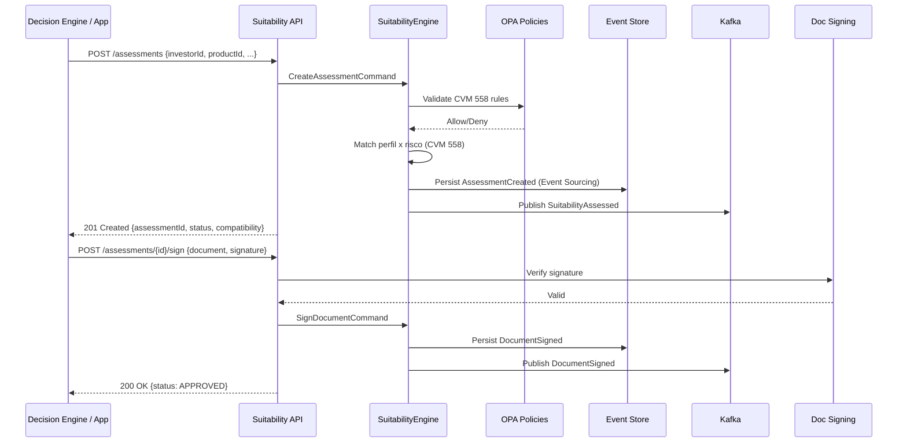

# Suitability Engine — CVM 558 (Suitability Assessment Service)

> **Microsserviço de produção** para avaliação de adequação de produtos de investimento (CVM 558) no Itaú Unibanco.
> **Hexagonal** + **Event Sourcing** + **OPA Policies** + **Harness CI/CD** + **OTEL Observabilidade**.

---

## 🎯 Visão Geral

| Aspecto | Detalhes |
|---------|----------|
| **Domínio** | Suitability Assessment (CVM 558) — perfil x produto x risco |
| **Regulatório** | CVM 558, CVM 175, ANBIMA, Bacen (KYC/AML), LGPD, SOX |
| **Stack** | Java 21, Spring Boot 3.3, Maven, Kafka, PostgreSQL, EventStoreDB |
| **Arquitetura** | Hexagonal + Event Sourcing + CQRS + Saga |
| **AI-DLC** | Golden Sets 100%, Red Teaming, OPA Gates, Drift Detection |
| **Deploy** | Harness CI/CD (6 stages) + Canary → Blue-Green |
| **SLA** | Latency P99 < 500ms, Availability 99.99%, Zero violations |

---

## 🏗️ Arquitetura Hexagonal

```
suitability-engine/
├── domain/                              # 🎯 Núcleo puro (zero deps externas)
│   ├── model/
│   │   ├── investor/                    # Investor, InvestorProfile, KYCStatus
│   │   ├── product/                     # InvestmentProduct, RiskClassification
│   │   ├── assessment/                  # SuitabilityAssessment (Aggregate Root)
│   │   ├── valueobjects/                # InvestorId, ProductId, AssessmentId, RiskLevel
│   │   └── events/                      # Domain Events (AssessmentCreated, Approved, etc.)
│   ├── service/
│   │   ├── SuitabilityEngine.java       # Domain Service (regras puras CVM 558)
│   │   ├── RiskClassifier.java          # Classificação de risco do produto
│   │   └── ProfileMatcher.java          # Match perfil x risco (CVM 558)
│   ├── repository/                      # Repository Interfaces (Ports)
│   └── exception/                       # Domain Exceptions
├── application/                         # 🔄 Casos de uso
│   ├── command/
│   │   ├── CreateAssessmentCommand.java
│   │   ├── ReassessCommand.java
│   │   ├── SignDocumentCommand.java
│   │   └── ExpireAssessmentCommand.java
│   ├── query/
│   │   ├── GetAssessmentQuery.java
│   │   ├── GetInvestorProfileQuery.java
│   │   └── ListPendingAssessmentsQuery.java
│   ├── saga/
│   │   └── OnboardingSuitabilitySaga.java
│   └── mapper/
├── infrastructure/                      # 🔌 Adapters
│   ├── persistence/
│   │   ├── jpa/                         # Spring Data JPA Repositories
│   │   ├── eventstore/                  # EventStoreDB (Event Sourcing)
│   │   └── mapper/                      # JPA ↔ Domain Mappers
│   ├── messaging/
│   │   ├── kafka/                       # Kafka Producers/Consumers
│   │   └── outbox/                      # Outbox Pattern
│   ├── external/
│   │   ├── kyc/                         # KYC Client (Bacen 3.978)
│   │   ├── document/                    # Document Signing (MCP)
│   │   └── datacatalog/                 # Data Catalog (MCP)
│   ├── security/
│   │   ├── vault/                       # HashiCorp Vault
│   │   └── lgpd/                        # LGPD Anonymizer
│   └── observability/
│       ├── tracer/                      # OTEL InvestmentsTracer
│       └── metrics/                     # Micrometer + Prometheus
├── interfaces/                          # 🌐 Entry Points
│   ├── rest/                            # REST Controllers (OpenAPI 3.1)
│   ├── grpc/                            # gRPC Services (high-perf)
│   └── messaging/                       # Kafka Listeners
└── shared/                              # 📦 Kernel
    ├── kernel/                          # Base classes, Result<T>, Validation
    ├── config/                          # Spring Configuration
    └── test/                            # Test fixtures, builders, containers
```

---

## 🔄 Fluxo Principal (Suitability Assessment)



---

## 🔒 Compliance Gates (CVM 558 - OPA/Rego)

```rego
# policies/cvm558/suitability.rego
package cvm558.suitability

# Art. 5º: Avaliação obrigatória antes de recomendar
deny[msg] {
    input.operation == "investment_recommendation"
    not input.suitability_assessment_done
    msg := "CVM 558 Art. 5º: Avaliação de suitability obrigatória"
}

# CONSERVADOR → apenas BAIXO/MEDIO
deny[msg] {
    input.investor_profile == "CONSERVADOR"
    input.product_risk in ["ALTO", "MUITO_ALTO"]
    msg := "CVM 558: CONSERVADOR incompatível com risco ALTO/MUITO_ALTO"
}

# MODERADO → não MUITO_ALTO
deny[msg] {
    input.investor_profile == "MODERADO"
    input.product_risk == "MUITO_ALTO"
    msg := "CVM 558: MODERADO incompatível com risco MUITO_ALTO"
}

# Termo assinado obrigatório
deny[msg] {
    input.operation == "investment_recommendation"
    not input.suitability_document_signed
    msg := "CVM 558 Art. 7º: Termo de suitability assinado obrigatório"
}

# Perfil atualizado (≤ 24 meses)
deny[msg] {
    input.suitability_assessment_age_months > 24
    msg := "CVM 558: Perfil desatualizado (> 24 meses)"
}
```

---

## 🧪 Eval Gates (Golden Sets - 100% Accuracy)

```python
# evals/suitability-thresholds.py
SUITABILITY_THRESHOLDS = {
    "suitability_accuracy": 1.0,           # 100% compatibilidade perfil x produto
    "cvm558_compliance": 1.0,              # 100% regras CVM 558
    "hallucination_rate": 0.0,
    "pii_leakage": 0.0,
    "latency_p95_ms": 500,
    "cost_per_assessment_usd": 0.05,
}

# evals/golden-set-suitability.yaml
test_cases:
  - id: "suit-001"
    description: "CONSERVADOR + produto BAIXO = COMPATIBLE"
    input: {investor_profile: "CONSERVADOR", product_risk: "BAIXO"}
    expected: {compatible: true, cvm_articles: ["Art. 5º", "Art. 12º"]}
  
  - id: "suit-002"
    description: "CONSERVADOR + produto ALTO = INCOMPATIBLE"
    input: {investor_profile: "CONSERVADOR", product_risk: "ALTO"}
    expected: {compatible: false, violation: "CVM 558 Art. 12º"}
  
  - id: "suit-003"
    description: "MODERADO + MUITO_ALTO = INCOMPATIBLE"
    input: {investor_profile: "MODERADO", product_risk: "MUITO_ALTO"}
    expected: {compatible: false, violation: "CVM 558 Art. 12º"}
  
  - id: "suit-004"
    description: "Perfil desatualizado > 24 meses = REJECT"
    input: {assessment_age_months: 25}
    expected: {compatible: false, violation: "Perfil desatualizado"}
```

---

## 🚀 Pipeline Harness (6 Stages)

```yaml
# .harness/ci/suitability-ci.yaml
pipeline:
  name: Suitability Engine CI/CD
  identifier: suitability_ci_cd
  stages:
    - stage: Code Quality & Compliance
      steps: [Java Build, SAST, SCA, Secrets, OPA CVM 558]
    - stage: AI Evaluation (Suitability Gates)
      steps: [Golden Set 100%, Red Teaming, Chaos Tests]
    - stage: Build & Scan
      steps: [Docker Distroless, SBOM, Cosign, Container Scan]
    - stage: Deploy Staging (Canary 5% → 25% → 50% → 100%)
    - stage: Deploy Production (Blue-Green + 3 Approvals)
    - stage: Feedback Loop (Violation Rate = 0%, Drift, Cost)
```

---

## 📊 Observabilidade (OTEL)

```java
// infrastructure/observability/tracer/InvestmentsTracer.java
@Component
public class InvestmentsTracer {
    private final Tracer tracer = GlobalOpenTelemetry.getTracer("investments.suitability");
    
    public <T> T traceAssessment(String operation, String assessmentId, Supplier<T> fn) {
        return tracer.spanBuilder("suitability." + operation)
            .setAttribute("investments.operation_type", "suitability")
            .setAttribute("investments.assessment_id", assessmentId)
            .setAttribute("investments.domain", "suitability")
            .setSpanKind(SpanKind.INTERNAL)
            .startScopedSpan(span -> {
                try {
                    T result = fn.get();
                    span.setAttribute("investments.success", true);
                    return result;
                } catch (Exception e) {
                    span.setAttribute("investments.success", false);
                    span.setAttribute("investments.error_type", e.getClass().getSimpleName());
                    span.recordException(e);
                    throw e;
                }
            });
    }
}
```

---

## 🚀 Quick Start

```bash
# 1. Clone
git clone https://github.com/rodrigosabreu/suitability-engine.git
cd suitability-engine

# 2. Build & Test Local
./mvnw verify -DskipITs=false

# 3. Run Local (Testcontainers)
docker-compose up -d postgres kafka eventstore
./mvnw spring-boot:run

# 4. Test API
curl -X POST localhost:8080/api/v1/assessments \
  -H "Content-Type: application/json" \
  -d '{"investorId": "inv-123", "productId": "prod-456", "idempotencyKey": "key-123"}'

# 5. Pipeline Harness
harness pipeline run --project suitability-engine --pipeline suitability_ci_cd
```

---

## 📋 Checklist de Produção

- [ ] Golden Sets 100% passing (suitability_accuracy = 1.0)
- [ ] OPA Gates 0 violações (CVM 558 Art. 5º, 7º, 12º)
- [ ] Red Teaming: 0 vulnerabilidades (injection, PII, financial)
- [ ] Chaos Tests: Kafka down, DB latency, network partition
- [ ] Contract Tests (Pact) passing
- [ ] Event Sourcing: Hash chain íntegro (Merkle tree)
- [ ] LGPD: @Anonymize em todos eventos, zero PII logs
- [ ] Vault: Zero secrets no código
- [ ] Canary 5% → 25% → 50% → 100% (segmento controlado)
- [ ] Rollback < 30s (feature flag kill switch)
- [ ] SLA: P99 < 500ms, Availability 99.99%
- [ ] Alertas: violation_rate > 0, latency P99 > 500ms

---

## 📚 Referências Regulatórias

| Norma | Artigos Relevantes |
|-------|-------------------|
| **CVM 558** | Art. 5º (avaliação), Art. 7º (termo), Art. 12º (perfis x risco) |
| **CVM 175** | Art. 77 (concentração), Art. 81 (alavancagem), Art. 85 (liquidez) |
| **ANBIMA** | Código de Administração (TWR, rebalancing) |
| **Bacen 3.978** | KYC/AML, liquidação D+0/D+1 |
| **LGPD** | Art. 7º (base legal), Art. 11º (sensíveis), Art. 18º (direitos) |
| **SOX** | Trilha imutável, segregação, aprovação |

---

*Serviço de produção — versão 1.0.0 — Itaú Unibanco — Harness Engineering*